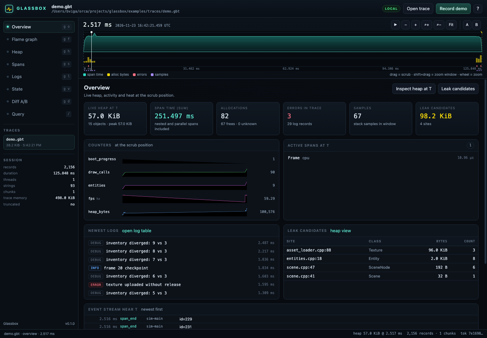
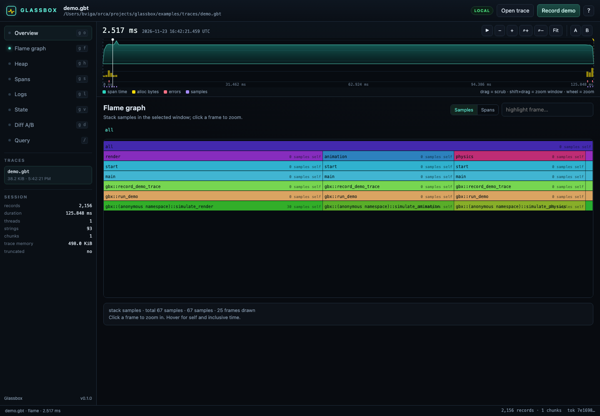
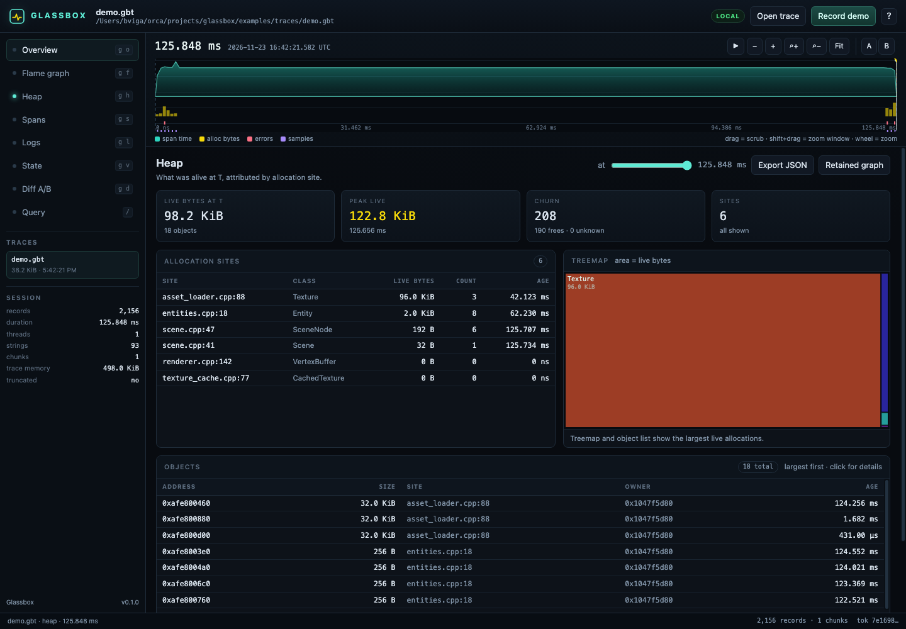

# Glassbox

Glassbox is a time-travel inspector for native C++ applications. It records CPU
samples, allocations, spans, logs, counters and state snapshots into a portable
trace, then lets you scrub backwards and forwards through an execution: what was
alive at time T, which code allocated it, which span was active, and what changed
between two moments.

It is a local desktop workbench, not a CLI and not a toy. The UI is served from
a loopback HTTP/SSE server embedded in the binary; the HTML, CSS and JavaScript
are compiled in. There are no third-party dependencies, no CDNs, no external
fonts or assets, and no network access at runtime.



## What it shows

- **Timeline** — span activity, allocation bytes, errors and samples over time,
  with scrubbing, window zoom, A/B markers and playback.
- **Heap at T** — live bytes, allocation sites, per-object ages, owners,
  treemap and a retained-size dominator graph.
- **Leaks** — candidates were allocated but never freed, ranked by size and age.
- **Flame graphs** — stack samples aggregated into an icicle chart with zoom,
  search and self/inclusive time; falls back to span durations when a trace has
  no samples.
- **Spans** — active span tree at the scrub position plus a waterfall and table.
- **Logs** — filterable, bounded log table.
- **State** — merged snapshot state at T and an A/B change view.
- **Diff** — deterministic comparison of heap sites, span aggregates, counters,
  logs and state between two moments.
- **Query** — predicates such as `type:alloc AND size > 1024 AND site ~ "asset"`.
- **Live recording** — record the demo while the UI streams events over SSE.


*Sample-based flame graph with real symbols, zoomable frames and sample counts.*


*Heap at the final moment: leak candidates, site table, treemap and owned objects.*

## Build

Requires macOS, Apple Clang with C++20, CMake 3.20+ and Ninja.

```sh
cmake -S . -B build -G Ninja -DCMAKE_BUILD_TYPE=Release
cmake --build build -j
ctest --test-dir build --output-on-failure
```

Or `make build test`, or `cmake --preset release && cmake --build --preset release`.

## Run

```sh
./build/glassbox                      # newest trace, or records the demo
./build/glassbox path/to/file.gbt     # open a trace
./build/glassbox_demo                 # record the demo, then open the UI
./build/glassbox_basic                # tiny embedding example
```

The launcher binds the first free port in 7331..7340 (or an ephemeral port),
opens the default browser at a URL carrying a one-time session token, and waits.
Use `--no-browser` for tests or remote SSH. No terminal interaction is needed.

## Embedding

```cpp
#include <glassbox/glassbox.hpp>

gbx::Recorder recorder;
recorder.start("traces/session.gbt");
gbx::AllocationTracker tracker(recorder);

{
  auto span = recorder.begin_span("Decode", "cpu");
  recorder.log(gbx::LogLevel::Info, "decoding payload", "io");
  auto* buffer = new char[4096];
  tracker.alloc(buffer, 4096, GBX_HERE, "Buffer");
  recorder.counter("bytes", 4096, "B");
  recorder.snapshot({{"queue_depth", 3}, {"mode", 1.0}});
  tracker.free(buffer);
  delete[] buffer;
}
recorder.finish();
```

See [docs/recorder.md](docs/recorder.md) for threading, spans, bounded queues,
drop accounting, allocation hooks and live sinks.

## How it works

- `src/trace/` — binary format with CRC-checked chunks, per-chunk string tables,
  bounds-checked varints and clean truncation recovery.
- `src/recorder/` — fixed-size multi-producer ring, writer thread, spans, logs,
  counters, snapshots and samples. Every drop is reported and persisted.
- `src/alloc/` — bounded object registry, source-located tracker, opt-in
  `operator new/delete` hooks in a separate library.
- `src/sample/` — manual frame-pointer stack capture, Mach thread sampling with
  `mach_vm_read_overwrite` validation, `dladdr` symbolization and demangling.
- `src/analysis/` — span tree, timeline, counter/state replay, heap
  reconstruction, leak ranking, flame aggregation, dominator-based retained
  sizes and deterministic diffs.
- `src/query/` — bounded predicate parser and evaluator.
- `src/ui/` — loopback HTTP/1.1 server, SSE, JSON, authentication, trace
  registry, demo recording, browser launcher and embedded assets.
- `src/demo/` — the scripted workload with a real leak, a 120 ms spike and a
  state drift.
- `examples/` — demo and basic embedding programs, plus the golden trace
  `examples/traces/demo.gbt`.

Every public header is documented; threading and lifetime rules are stated.
Malformed traces, queries and HTTP requests fail with `Status`/4xx instead of
crashing, and all parsing paths are bounded.

## Testing

Unit tests cover codecs, format round-trips, truncation/corruption, the
recorder under concurrency, allocation hooks, sampling, every analysis module,
queries, JSON, HTTP and the full workbench (including SSE). Deterministic fuzz
harnesses mutate traces, queries, JSON and raw HTTP. Benchmarks measure the
recorder, trace I/O and analyses on the machine that runs them.

```sh
ctest --test-dir build --output-on-failure
make fuzz
./build/bench/glassbox_bench
make asan   # address+undefined
make tsan   # thread sanitizer
```

Details: [docs/testing.md](docs/testing.md).

## Constraints and non-goals

Glassbox is deliberately dependency-free and local. It is not a profiler for
remote machines, not a sampling agent for production, and not a Git-like tool.
The trace format is versioned; the UI never loads more than its configured
limits. See [LIMITATIONS.md](LIMITATIONS.md) for the honest list of gaps.

## Documentation

- [Trace format](docs/trace-format.md)
- [Recorder API](docs/recorder.md)
- [Analysis](docs/analysis.md)
- [Query language](docs/query.md)
- [Workbench](docs/workbench.md)
- [Testing](docs/testing.md)
- [Changelog](CHANGELOG.md)
- [Limitations](LIMITATIONS.md)

## License

MIT. See [LICENSE](LICENSE).
