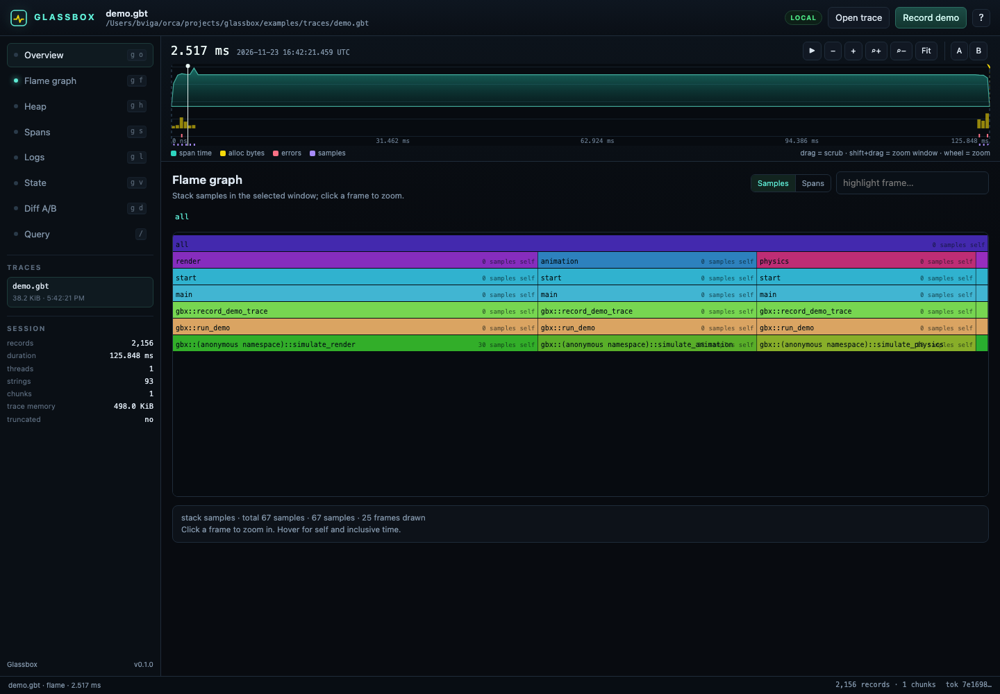
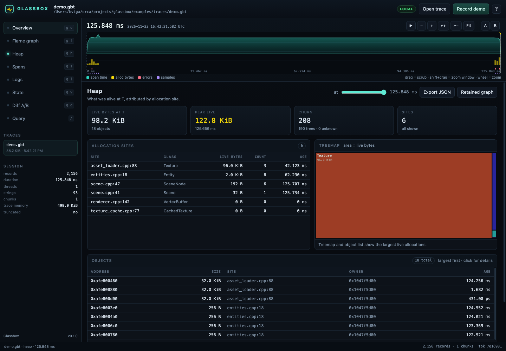

# Workbench and local server

The workbench is a local web application. The launcher starts an HTTP/SSE
server bound to `127.0.0.1`, then opens the default browser at a URL carrying a
random session token. HTML, CSS, JavaScript, the favicon and the SVG logo are
compiled into the binary; nothing is fetched from the network at runtime.

## Starting it

```
./build/glassbox                        # newest trace, or record the demo
./build/glassbox --trace path.gbt
./build/glassbox --trace-dir traces --port 7331 --no-browser
./build/glassbox_demo                   # record the demo then open it
```

Flags: `--trace`, `--trace-dir`, `--port`, `--no-browser`, `--no-record`,
`--help`. The demo binary adds `--out`, `--frames`, `--mach-sampler`,
`--no-serve`.

The launcher prints one line with the URL (useful in logs) and then waits. It
requires no terminal interaction: use the browser to close it, or press the
"shutdown" endpoint through the UI. SIGINT/SIGTERM also stop it cleanly.

## Authentication and isolation

- The server binds only to `127.0.0.1` (IPv4 loopback). Binding another host is
  rejected.
- A 128-bit token is generated with `arc4random_buf` at startup. It is accepted
  via `X-Glassbox-Token`, the `t` query parameter, or the `gb_token` cookie.
- The initial URL contains `?t=...`; the index response sets an HttpOnly,
  SameSite=Strict cookie so subsequent asset requests authenticate without
  JavaScript access to the token.
- Every route, including static assets, requires the token. Requests without
  it receive `403`.
- The `Host` header must be `127.0.0.1` or `localhost` (optional port). An
  `Origin` header, when present, must match the local origin. This blocks DNS
  rebinding and cross-site requests even if a token leaked into a local page.
- Responses carry `X-Content-Type-Options: nosniff`, `Referrer-Policy:
  no-referrer`, `Cache-Control: no-store`, and the page carries a strict CSP
  (`default-src 'self'`, no frames, no forms, no external sources).

The token is regenerated per process; it is not persisted anywhere.

## Trace roots

The server may only list and open `.gbt` files under:

- the primary trace directory (`--trace-dir`, default `traces`), created on
  startup;
- `examples/traces` when launched by the main binary;
- extra directories passed to `WorkbenchOptions::extra_trace_dirs`.

Paths are canonicalized with `weakly_canonical`, must be regular files, must
end in `.gbt`, and must be at most 512 MiB. Paths outside the roots are
rejected with `PermissionDenied`. The UI never accepts a path from a URL
segment; opening is a POST with a JSON body.

## Routes

| Method | Path | Purpose |
|---|---|---|
| GET | `/` | workbench HTML (sets cookie) |
| GET | `/app.js`, `/style.css`, `/favicon.svg` | embedded assets |
| GET | `/api/health` | version, uptime, recording state, trace-loaded flag |
| GET | `/api/traces` | trace files under the roots, newest first |
| POST | `/api/open` | `{"path": "..."}` loads a trace |
| POST | `/api/demo` | starts a demo recording (`frames`, `sampler`, `sleep_spike`) |
| POST | `/api/shutdown` | stops the server |
| GET | `/api/meta` | trace metadata, thread names, type counts, markers, counters, state keys |
| GET | `/api/timeline` | `from`, `to`, `buckets` |
| GET | `/api/events` | `from`, `to`, `limit`, `newest`, `types`, `thread`, `q` |
| GET | `/api/event` | `id` (record index) |
| GET | `/api/logs` | window, `level`, `limit`, `q`, `newest` |
| GET | `/api/spans` | `at` for active spans, or `from`/`to` for the span list |
| GET | `/api/span` | `id` |
| GET | `/api/heap` | `at`, `limit` |
| GET | `/api/heap/graph` | `at`, `nodes` (retained sizes and dominators) |
| GET | `/api/leaks` | `limit` |
| GET | `/api/flame` | `from`, `to`, `mode=samples|spans`, `nodes` |
| GET | `/api/state` | `at` |
| GET | `/api/counters` | `name`, `points` |
| GET | `/api/diff` | `a`, `b`, `limit` |
| GET | `/api/query` | `q`, `from`, `to`, `limit`, `newest` |
| GET | `/api/live` | Server-Sent Events stream |

Numbers in query strings are clamped to safe maxima; malformed numbers fall
back to defaults rather than crashing. Unknown record types in `types=` yield
400. Invalid query syntax yields 400 with `{error, offset}`.

## Live streaming

`/api/live` is an SSE stream. It is active during a demo recording, started by
`POST /api/demo`, and also attaches to a recording already in progress after a
reload (the health endpoint reports `recording`).

Events:

- `record` — one JSON record, already string-resolved, identical in shape to
  `/api/events` records without the index.
- `gap` — `{"dropped": n}` when a slow subscriber fell behind the bounded feed.
- `done` — final JSON summary (`ok`, `path`, `records`, `frames`,
  `allocations`, `leaks`, `samples`, `live_dropped`) and the stream closes.
- `error` — authentication or recording failure.

The feed is bounded at 1,024 events and 16 KiB per event; excess is dropped and
accounted, never buffered unboundedly. Subscribers wait with a 500 ms poll
interval and receive comments as keepalives. On shutdown, streams observe the
stop flag within half a second.

## HTTP server behaviour

- One request per connection, `Connection: close`, no keep-alive.
- Request header block ≤ 32 KiB, body ≤ 1 MiB, at most 100 headers and 32 query
  parameters.
- Methods: GET, POST, HEAD (HEAD falls back to the GET route). Everything else
  is 405.
- `Transfer-Encoding` is rejected (501); duplicate or malformed
  `Content-Length` is 400; oversized bodies are 413; too many headers 431.
- Percent-decoding is checked; NUL bytes and `..` path segments are rejected.
- Accepted sockets have `SO_NOSIGPIPE`, blocking mode and a 10 s I/O timeout.
- At most 64 concurrent connections; beyond that the server answers 503.
- Handler exceptions become 500 JSON. Responses are capped at 32 MiB.
- SSE bytes are written after `200 OK` with `Content-Type: text/event-stream`
  and no `Content-Length` (the stream ends by closing the connection).

## Threads

The accept loop runs on its own thread and spawns detached worker threads
(bounded by the connection cap). The trace registry, live feed and recording
state are independently locked/atomic. `Workbench::stop` first stops the live
feed, joins the demo thread, then asks the server to stop and waits for every
worker to finish before destroying state. SSE handlers poll the stop flag, so
shutdown is prompt.

## Demo recording

`POST /api/demo` records a real workload: a game-loop span tree, actual `new`
allocations tracked through `AllocationTracker` (some owned by a live scene
graph and some leaked on purpose), counters, gauges, logs, state snapshots with
a drifting inventory count, a 120 ms latency spike, and manual stack samples.
The trace is written to `<trace root>/demo-live.gbt` and then loaded. Memory
intentionally leaked in the trace is freed immediately after the recorder
closes, so the process stays clean while the file still shows the leak.

## Assets

`ui/index.html`, `ui/app.js`, `ui/style.css` and `ui/favicon.svg` are embedded
at configure time by `cmake/EmbedAssets.cmake` using only CMake (`file(READ ...
HEX)`), producing `embedded_assets.cpp`. Editing an asset triggers a
reconfigure because the asset list is marked as a configure dependency. There
are no external fonts, CDNs, images or JavaScript libraries.

## UI overview

- Timeline canvas: stacked span activity, allocation bytes, error ticks, sample
  marks, A/B markers, selected window, wheel zoom, drag scrub, shift-drag
  window selection.
- Overview: live heap at T, window span time, churn, errors, samples, leak
  candidates, counter sparklines, active spans, recent logs, event feed.
- Flame: icicle canvas with zoom breadcrumbs, hover details, search highlight,
  sample/span modes, truncation notice.

  
- Heap: site table, treemap, object table, retained-graph mode, per-object
  inspector with the originating allocation record, and a moment export.

  
- Spans: waterfall canvas, active span tree, span table, inspector.
- Logs: level filters, text filter, newest-first table.
- State: merged snapshot state at T and A/B change view.
- Diff: heap/spans/counters/logs/state deltas between A and B.
- Query: predicate input, parse errors, result table.
- Keyboard: space play/pause, arrows step, `[`/`]` set A/B, `g`+letter views,
  `/` query, `Esc` close/reset.
